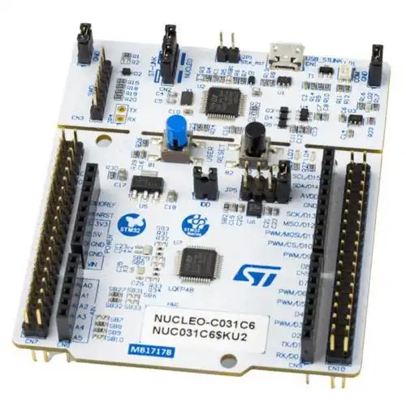
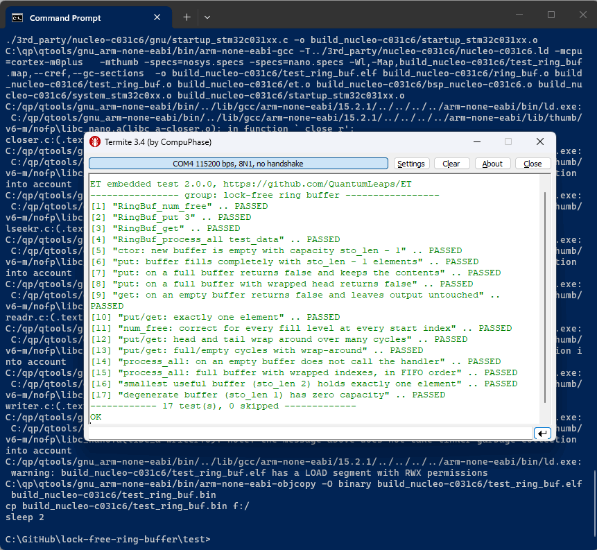

## Brought to you by:
[](https://www.state-machine.com)
<hr>

[](https://github.com/QuantumLeaps/lock-free-ring-buffer/releases/latest)
[](https://github.com/QuantumLeaps/lock-free-ring-buffer/blob/master/LICENSE)

# What is it?
"Lock-Free Ring Buffer" (LFRB) is a minimal, customizable implementation
of a ring buffer (a.k.a. circular buffer) in C, specifically suitable
for embedded systems, such as single-core microcontrollers with:
- ARM Cortex-M CPU
- MSP430 CPU
- PIC24/dsPIC CPU
- other similar 16/32-bit CPUs

> **NOTE** The presented LFRB implementation is intended for deeply embedded
systems, such as single-core ARM Cortex-M MCUs without cache memories.
The presented implementation might not be appropriate for complex multi-core
SoCs with cache memory, etc. Please refer to the literature, for example:
- [<i>Correct and Efficient Bounded FIFO Queues</i>](lit/RR-8365.pdf).
- [<i>Optimised Lock-Free FIFO Queue</i>](lit/Optimised_lock_free_FIFO_queue.pdf).

# Lock-Free Restrictions
The ring buffer does not require any "locking" (mutual exclusion
mechanism) as long as the following restrictions are met:

1. Only one thread/interrupt can produce data into the ring buffer
2. Only one thread/interrupt can consume data from the ring buffer
3. Both the producer and consumer run on the same CPU
4. The system has strong memory consistency
5. Additional assumptions about the "atomicity" of the LFRB counters
are spelled out in the [ring_buf.h](src/ring_buf.h) header file

In other words, LFRB is a **single-producer, single-consumer FIFO**.
Fortunately, this is the most frequently encountered scenario in deeply
embedded applications.

# Code Structure
The ring buffer implementation consists of two files located in the
src directory:

- [ring_buf.h](src/ring_buf.h)  - contains the interface
- [ring_buf.c](src/ring_buf.c)  - contains the implementation

The ring buffer holds elements of they type RingBufElement, which
can be customized (typically `uint8_t`, `uint16_t`, `uint32_t`, `float`,
`void*` (pointers), etc.)


# Test/Example of Use
The directory `et` contains the
[<b>Embedded Test (ET)</b>](https://github.com/QuantumLeaps/Embedded-Test)
super-simple testing framework. ET is used to test the LFRB.

<p align="center">
<a title="ET on GitHub" href="https://github.com/QuantumLeaps/Embedded-Test"></a>
</p>

Specifically, the ET tests and examples of use of LFRB are located in the file:

- [test/test_ring_buf.c](test/test_ring_buf.c) - example of use and tests the LFRB.

## Test Suite
The test suite consists of 18 tests in one ET test group
("lock-free ring buffer"). Helpers used by the tests:

- `rb_advance()` moves head and tail of an empty buffer forward with
  put/get pairs (public API only), to place the indexes at any start position.
- `rec_handler()` records the elements that `RingBuf_process_all()` passes
  to it.

| # | Test | Boundary / behavior checked |
|---|---|---|
| 1 | RingBuf_num_free | free space of a new buffer is `sto_len - 1` |
| 2 | RingBuf_put 3 | free space after putting 3 elements |
| 3 | RingBuf_get | the 3 elements come out in FIFO order; get on the empty buffer fails |
| 4 | RingBuf_process_all test_data | `process_all` hands every element to the handler and empties the buffer |
| 5 | ctor: new buffer is empty with capacity sto_len - 1 | initial state; a failing get leaves `*pel` unchanged |
| 6 | put: buffer fills completely with sto_len - 1 elements | filling completely; `num_free` checked after every put |
| 7 | put: on a full buffer returns false and keeps the contents | put on full (twice); the rejected element is not stored; FIFO order kept |
| 8 | put: on a full buffer with wrapped head returns false | full state when head has wrapped (`head == tail-1`, head < tail) |
| 9 | get: on an empty buffer returns false and leaves output untouched | get on empty after draining, run twice |
| 10 | put/get: exactly one element | one element; element value 0x00 |
| 11 | num_free: correct for every fill level at every start index | all 8 start indexes x 8 fill levels, covering `head==tail`, `head>tail` and `head<tail` |
| 12 | put/get: head and tail wrap around over many cycles | wrap-around: 70 000 cycles x 3 puts/3 gets (210 000 operations, more than 2^16); every index position is visited; FIFO data checked; the 8-bit element values also wrap |
| 13 | put/get: full/empty cycles with wrap-around | 16 cycles of fill-to-full/drain-to-empty, with the indexes moving each cycle |
| 14 | process_all: on an empty buffer does not call the handler | process_all on empty, both fresh and with the indexes at `end-1` |
| 15 | process_all: full buffer with wrapped indexes, in FIFO order | the handler sees every element in order across the wrap; the buffer is still usable afterwards |
| 16 | smallest useful buffer (sto_len 2) holds exactly one element | capacity 1, full/empty, index wrap every 2 operations, process_all |
| 17 | degenerate buffer (sto_len 1) has zero capacity | put always fails, the storage is not written, get fails, the handler is never called |
| 18 | largest buffer (sto_len 0xFFFF): indexes wrap at RingBufCtr max | the `uint16_t` index limit: fill 0xFFFE elements, put on full, head and tail wrap 0xFFFE->0. Guarded by `#ifdef Q_HOST` (needs 64 KB of RAM) |

Tests 5-18 each construct their own buffer with `RingBuf_ctor()`, so they
do not depend on each other. Tests 1-4 share one global buffer and are
meant to run in sequence.

### Code Coverage
The test `Makefile` always builds the tests with coverage instrumentation
and reports the coverage of the code under test (`src/ring_buf.c`) after
every run (see [Testing on the Host](#testing-on-the-host)):

| Metric | Coverage of `src/ring_buf.c` |
|---|---|
| Statements (lines) | 44/44 = **100%** |
| Branches | 16/16 = **100%** |
| Condition outcomes (gcc 14+) | 16/16 = **100%** |

The coverage was also cross-checked with `-O0` (the project builds at `-O`,
which can merge branches): 46/46 lines and 16/16 branches.

> **NOTE**<br>
The complete coverage report, including the **condition coverage**
(`-fcondition-coverage`, `gcov -g`), requires **GCC 14 or newer**.
With older GCC, the `Makefile` falls back to `-fprofile-arcs -ftest-coverage`
and `gcov -b`, which reports statement and branch coverage only.

### Mutation Check
100% coverage alone does not show that the tests check the results.
Therefore, 11 single-change mutants of `ring_buf.c` were run against the
test suite. The suite detects (kills) all 11:

| Mutant | Result |
|---|---|
| put: no head wrap | killed |
| put: no full check | killed |
| put: off-by-one full check | killed |
| get: no tail wrap | killed |
| get: no empty check | killed |
| num_free: empty returns `end` | killed |
| num_free head<tail: missing `-1` | killed |
| num_free head>tail: missing `-1` | killed |
| num_free: `<` swapped to `>` | killed |
| process_all: wrong tail wrap | killed |
| process_all: tail not stored | killed |

### Notes
- The usable capacity is `sto_len - 1`, because one slot is kept empty to
  tell "full" from "empty" (tests 6, 16 and 17). Consequently, `sto_len == 1`
  gives a buffer that can never hold an element.
- `sto_len == 0` is not checked by `RingBuf_ctor()`. In that case
  `RingBuf_put()` would write `sto[0]`. Always provide `sto_len >= 2`.
- The host tests are single-threaded, so they cannot check the lock-free
  (acquire/release) properties between the producer and the consumer.
  These properties have been checked by the
  [independent testing](#independent-testing) described below.

## Testing on the Host
To build and run the tests on the host, open a terminal, change to the `test`
sub-directory and type `make`. The tests run and then `gcov` reports the
coverage of `ring_buf.c` in the file `ring_buf.cov` (also shown on the
console) and in the annotated source file `ring_buf.c.gcov`. The generated
output (with GCC 14) is shown below (the dependency-generation lines are
omitted):

```
make
gcc -c -g -O -fno-pie -std=c11 -pedantic -Wall -Wextra -W --coverage -fcondition-coverage   -I. -I../src -I../et  -DQ_HOST ../src/ring_buf.c -o build_host/ring_buf.o
gcc -c -g -O -fno-pie -std=c11 -pedantic -Wall -Wextra -W --coverage -fcondition-coverage   -I. -I../src -I../et  -DQ_HOST test_ring_buf.c -o build_host/test_ring_buf.o
gcc -c -g -O -fno-pie -std=c11 -pedantic -Wall -Wextra -W --coverage -fcondition-coverage   -I. -I../src -I../et  -DQ_HOST ../et/et.c -o build_host/et.o
gcc -c -g -O -fno-pie -std=c11 -pedantic -Wall -Wextra -W --coverage -fcondition-coverage   -I. -I../src -I../et  -DQ_HOST ../et/et_host.c -o build_host/et_host.o
gcc     --coverage -fcondition-coverage   -no-pie  -o build_host/test_ring_buf build_host/ring_buf.o build_host/test_ring_buf.o build_host/et.o build_host/et_host.o
rm -f build_host/*.gcda
build_host/test_ring_buf

ET embedded test 2.0.0, https://github.com/QuantumLeaps/ET
---------------- group: lock-free ring buffer -----------------
[1] "RingBuf_num_free" .. PASSED
[2] "RingBuf_put 3" .. PASSED
[3] "RingBuf_get" .. PASSED
[4] "RingBuf_process_all test_data" .. PASSED
[5] "ctor: new buffer is empty with capacity sto_len - 1" .. PASSED
[6] "put: buffer fills completely with sto_len - 1 elements" .. PASSED
[7] "put: on a full buffer returns false and keeps the contents" .. PASSED
[8] "put: on a full buffer with wrapped head returns false" .. PASSED
[9] "get: on an empty buffer returns false and leaves output untouched" .. PASSED
[10] "put/get: exactly one element" .. PASSED
[11] "num_free: correct for every fill level at every start index" .. PASSED
[12] "put/get: head and tail wrap around over many cycles" .. PASSED
[13] "put/get: full/empty cycles with wrap-around" .. PASSED
[14] "process_all: on an empty buffer does not call the handler" .. PASSED
[15] "process_all: full buffer with wrapped indexes, in FIFO order" .. PASSED
[16] "smallest useful buffer (sto_len 2) holds exactly one element" .. PASSED
[17] "degenerate buffer (sto_len 1) has zero capacity" .. PASSED
[18] "largest buffer (sto_len 0xFFFF): indexes wrap at RingBufCtr max" .. PASSED
------------ 18 test(s), 0 skipped -------------
OK
gcov -abcgum -o build_host ring_buf > ring_buf.cov
cat ring_buf.cov
File '../src/ring_buf.c'
Lines executed:100.00% of 44
Branches executed:100.00% of 16
Taken at least once:100.00% of 16
Calls executed:100.00% of 1
Condition outcomes covered:100.00% of 16
Creating 'ring_buf.c.gcov'

Lines executed:100.00% of 44
```

Other `make` targets: `make norun` (build only) and `make clean`
(remove the build and the coverage reports).

## Testing on STM32 NUCLEO-C031C6
The LFRB distribution provides a simple makefile (see [test/nucleo-c031c6.mak](test/nucleo-c031c6.mak)) to build the tests for the STM32 NUCLEO-C031C6 shown below.

<p align="center"></p>

> **REMARK**<br>
The STM32 NUCLEO board has been selected because it can be programmed by simply copying the binary image to the board enumerated as a USB drive.

The LFRB distribution contains all files required to build the binary image for the NUCLEO-C031C6 board. However, you still need to provide the GCC-ARM compiler and the serial terminal utility to receive the output produced by the board. To run the test on the STM32 NUCLEO-C031C6, you open a terminal window and type (please note the slash '/' character after the USB drive name 'g:/'):

```
cd lock-free-ring-buffer/test

make -f nucleo-c031c6.mak USB=g:/
```

> **NOTE**<br>
The GCC-ARM cross-compiler for Windows as well as the `make` utility are available in the [QTools collection](https://github.com/QuantumLeaps/qtools) for Windows.

The following screen shot shows the build process, programming the board (by copying the binary image) and the test output on the [Termite serial terminal](https://www.compuphase.com/software_termite.htm).

<p align="center"></p>

> **NOTE**<br>
Test 18 (the largest buffer) needs 64 KB of RAM and is therefore built
only on the host (`Q_HOST`).

## Independent Testing
LFRB 4.0.0 (commit `0d6354a`) has been tested independently by the
[verified-libs](https://verified-libs.org) project, which tests embedded
ring buffer libraries on real hardware with the same test suite for every
library. LFRB is used through the adapter
[adapter_qp_lfrb.c](https://github.com/verified-libs/verified-libs/blob/main/firmware/nrf5340-rb-bench/adapters_wave2/adapter_qp_lfrb.c)
(byte elements, 128 slots, `RingBuf_ctor()`/`RingBuf_put()`/`RingBuf_get()`).
LFRB needed nothing beyond the include path to build bare-metal
(arm-none-eabi-gcc 14.2.1, `-O2 -DNDEBUG`).

The verified-libs testing covers the concurrency properties that the
single-threaded host tests cannot check:

- **Model checking (GenMC, C11 memory model RC11):** all thread
  interleavings of single-element put/get between two threads:
  **pass** (7118 executions explored). The negative controls (release and
  acquire weakened to relaxed) are required to fail, and do.
- **ISR stress tests:** timer interrupt <-> main loop, in both directions,
  with random seeds and interrupt rates and with an "interrupt sweep" that
  hits every instruction boundary of a call, on six boards (nRF5340 DK,
  Raspberry Pi Pico 2, NUCLEO-G474RE, NUCLEO-H723ZG, NUCLEO-G0B1RE,
  SAM D20 Xplained Pro). A run counts only if a deliberately broken control
  buffer is caught. **No errors** were reported for LFRB.
- **Speed:** mean cycles per call (1-byte put / get, code in flash, cache on):

| nRF5340 (M33) | Pico 2 (M33) | G474 (M4) | H723 (M7) | G0B1 (M0+) | SAM D20 (M0+) |
|---|---|---|---|---|---|
| 50 / 44 | 39 / 36 | 46 / 46 | 47 / 42 | 69 / 61 | 70 / 63 |

> **NOTE**<br>
As of 2026-11-22, verified-libs labels its results as "harness development,
not published results". Please see the verified-libs
[RESULTS.md](https://github.com/verified-libs/verified-libs/blob/main/RESULTS.md)
and the [method](https://verified-libs.org/method.html) for the current
numbers and the details of the testing. LFRB has no block API, so the
verified-libs block-transfer numbers for LFRB are loops of single-element
calls.


# Licensing
The LFRB is [licensed](LICENSE) under the MIT open source license.


# Comments/Discussion
If you'd like to discuss LFRB or related subjects, please use the
["Issues" tab](https://github.com/QuantumLeaps/lock-free-ring-buffer/issues).

# How to Help this Project?
Please feel free to clone, fork, and make pull requests to improve LFRB.
If you like this project, please give it a star
(in the upper-right corner of your browser window):

<p align="center"></p>
